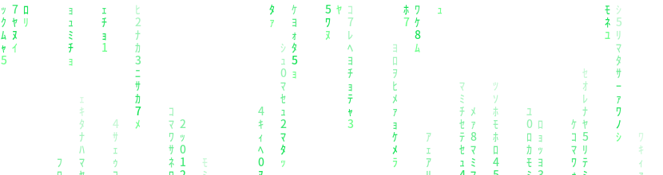

<h1 align="center">
   
  Hi, I'm Marlon 
</h1>

## Streak Stats

## My Skills Include

<h4> Languages </h4>

  
  
  

<h4> Other Tools and Technologies </h4>

  
  
  
  
  

<h4> IDEs and Editors </h4>

  
  
  
  

